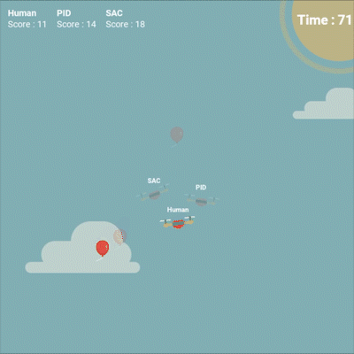

# Drone Control via Reinforcement Learning

Controlling a 2D Quadcopter with Rigidbody Physics using Control Theory and Reinforcement Learning

<p align="center">
  
</p>


**Subject:** Reinforcement Learning — Lab Evaluation Project  
**Algorithm:** Soft Actor-Critic (SAC)  
**Framework:** Stable-Baselines3 + Gymnasium + Pygame  
**Dataset:** We used a 2D drone simulation environment called DroneEnv, based on the open-source Quadcopter-AI project, and used a pre-trained SAC model.

---

## Overview

This project implements a 2D quadcopter simulation in which an autonomous agent learns to navigate and collect targets purely through interaction with the environment. No rules or heuristics are programmed into the RL agent — the policy is discovered entirely via trial-and-error.

Three controllers are compared under identical conditions:

| Controller | Type | Description |
|---|---|---|
| Human | Manual | Arrow-key input |
| PID | Classical Control | Proportional-Integral-Derivative controller |
| SAC | Reinforcement Learning | Soft Actor-Critic, trained on a custom Gymnasium environment |

**Research question:** Can a trained RL agent outperform a hand-crafted classical controller on a continuous control task?

---

## Results

Evaluated over a 100-second game window. Each drone independently pursues the same sequence of randomly placed targets.

| Agent | Targets Collected |
|---|---|
| Human | 4 |
| PID | 50 |
| **SAC** | **60** |

The SAC agent achieves the highest score, demonstrating that the learned policy surpasses both manual control and a tuned classical controller.

---

## Background

### Markov Decision Process Formulation

The drone control problem is modelled as an MDP `(S, A, R, T)`:

**State space** — 7-dimensional continuous observation vector:

```
[ angle_to_vertical,   # drone tilt in radians
  total_velocity,      # magnitude of velocity vector
  angular_velocity,    # rotation speed (rad/step)
  dist_to_target,      # Euclidean distance to target, normalised by 500
  angle_to_target,     # direction from drone to target (radians)
  velocity_alignment,  # angle between velocity vector and target direction
  dist_to_target ]     # repeated for input symmetry
```

**Action space** — 2 continuous values in [-1, 1]:

```
[ thrust_delta,        # combined thruster change (controls altitude)
  differential_thrust  # thrust difference    (controls rotation) ]
```

**Reward function:**

```
r(s, a) = +1.0   if dist_to_target < 50 px   (target reached)
          -1.0   if dist_to_target > 1000 px  (out of bounds)
          -d/500  otherwise                   (dense distance penalty)
```

The distance penalty is a form of **reward shaping** — it provides a learning signal at every step, which accelerates convergence compared to a purely sparse reward.

### Algorithm: Soft Actor-Critic

SAC is an **off-policy, model-free, maximum-entropy** deep RL algorithm designed for continuous action spaces. Key properties:

- **Actor-Critic architecture** — separate networks for policy (actor) and state-value estimation (critic)
- **Entropy regularisation** — the objective is `E[R] + alpha * H(pi)`, where `H(pi)` is policy entropy. This encourages exploration and prevents premature convergence.
- **Replay buffer** — transitions `(s, a, r, s')` are stored and sampled uniformly for off-policy updates, making it more sample-efficient than on-policy methods (e.g. PPO)
- **Soft target updates** — target network weights are updated via exponential moving average (`tau = 0.005`), stabilising training

SAC was preferred over DQN because the action space is continuous (real-valued thruster forces). DQN requires discretisation, which introduces approximation error and scaling problems.

---

## Project Structure

```
.
├── environment.py          # Custom Gymnasium MDP (core contribution)
├── train.py                # SAC training script with callbacks
├── evaluate.py             # Game simulation — runs all three agents live
├── plot_results.py         # Generates reward curve and score comparison charts
├── requirements.txt
├── agents/
│   ├── human_agent.py      # Keyboard-controlled drone
│   ├── pid_agent.py        # Nested PID loops for x/y/angle control
│   └── sac_agent.py        # Pre-trained SAC policy loader
├── models/
│   └── sac_drone.zip       # Trained model weights
├── results/
│   ├── reward_curve.png
│   └── score_comparison.png
└── assets/
    └── ...                 # Sprites and fonts
```

---

## Setup and Usage

### Requirements

- Python 3.10+
- macOS / Linux

### Installation

```bash
git clone <your-repo-url>
cd final_project

python3 -m venv venv
source venv/bin/activate

pip install -r requirements.txt
```

### Run the evaluation game

```bash
python evaluate.py
```

Controls: Arrow keys to fly your drone. Press `Q` to quit early.  
Scores are printed to the terminal at the end of the 100-second game.

### Generate result plots

```bash
python plot_results.py
```

Saves `results/reward_curve.png` and `results/score_comparison.png`.

### Train your own model (optional)

```bash
python train.py                   # 200,000 steps (~5 minutes)
python train.py --steps 1000000   # Longer training, better performance
```

The best checkpoint is saved to `models/best_model.zip` automatically via `EvalCallback`.

---

## Environment Details

The custom environment (`DroneEnv`) wraps a 2D Newtonian rigidbody simulation in a standard Gymnasium interface.

**Physics update per step:**

```
ax  = -(tl + tr) * sin(angle) / mass
ay  = gravity - (tl + tr) * cos(angle) / mass
ang_acc = arm * (tr - tl) / mass

x_vel += ax;  y_vel += ay;  ang_vel += ang_acc
x_pos += x_vel;  y_pos += y_vel;  angle += ang_vel
```

Where `tl` and `tr` are the left and right thruster forces computed from the agent's action.

**Episode termination:**
- Drone travels more than 1000 px from its target (out of bounds)
- 6000 steps elapsed (100 seconds at 60 FPS)

---

## Hyperparameters

| Parameter | Value |
|---|---|
| Learning rate | 3e-4 |
| Replay buffer size | 100,000 |
| Batch size | 256 |
| Discount factor (gamma) | 0.99 |
| Soft update coefficient (tau) | 0.005 |
| Entropy coefficient | auto-tuned |
| Policy network | MLP, 2 hidden layers x 256 units, ReLU |
| Training timesteps | 5,000,000 |

---

## PID Baseline

The PID controller uses two nested control loops:

1. **Horizontal:** x-position error → desired tilt angle → differential thruster force
2. **Vertical:** y-position error → desired y-velocity → combined thruster force

It serves as a strong non-learning baseline. That the SAC agent exceeds PID performance demonstrates the value of learned, rather than hand-crafted, control policies.

---

## References

- Haarnoja, T. et al. (2018). *Soft Actor-Critic: Off-Policy Maximum Entropy Deep Reinforcement Learning with a Stochastic Actor.* ICML 2018.
- Raffin, A. et al. (2021). *Stable-Baselines3: Reliable Reinforcement Learning Implementations.* JMLR.
- Base physics and assets adapted from [Quadcopter-AI](https://github.com/AlexandreSajus/Quadcopter-AI) (A. Sajus, MIT License).

---

## License

MIT
